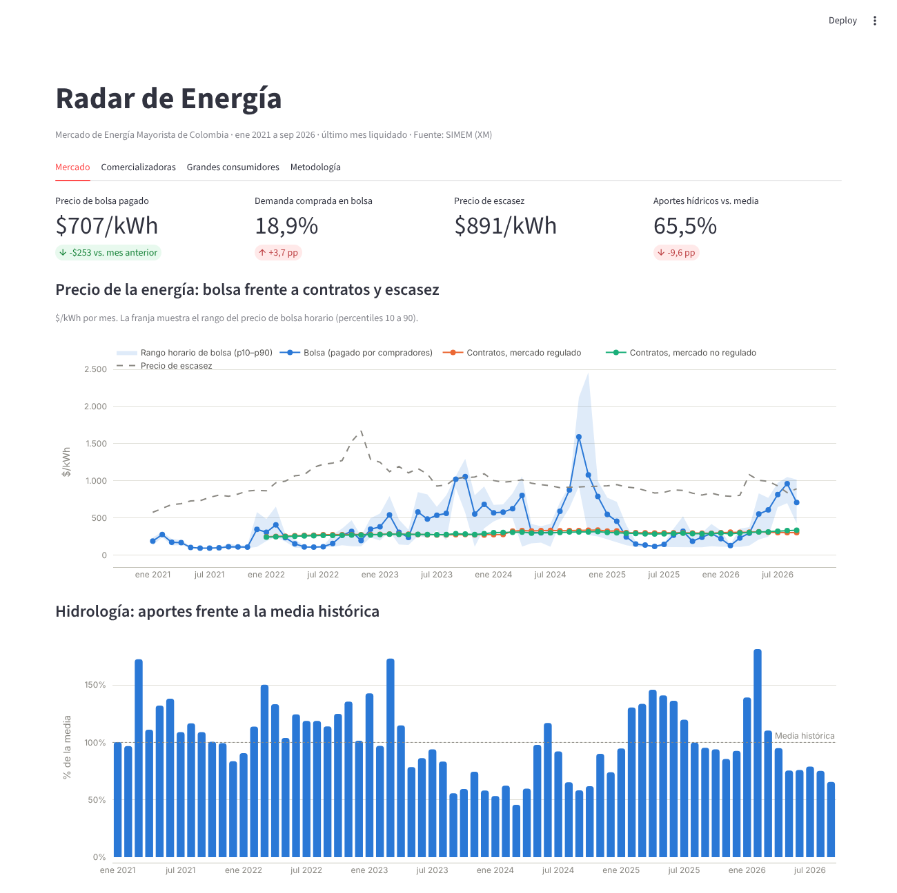
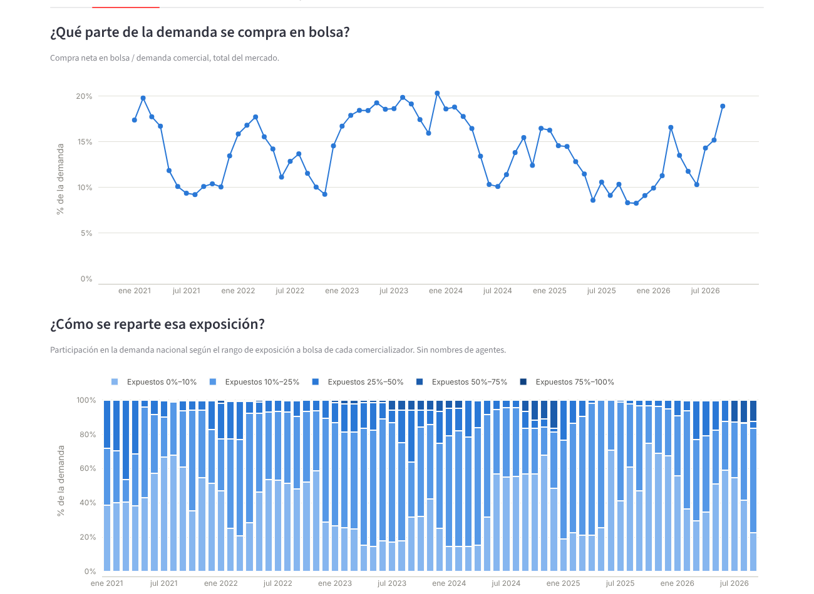

# Radar de Energía

**¿Qué tan expuestos están las comercializadoras y los grandes consumidores de Colombia al
precio de bolsa de la energía, y cuánto les cuesta?**

Dato maestro mensual del Mercado de Energía Mayorista construido con datos abiertos de
[SIMEM](https://www.simem.co/) (XM), y un panel de análisis con simuladores para tomar
decisiones de cobertura.

**Hallazgo principal (enero de 2021 a septiembre de 2026):** en 2023 y 2024, comprar energía en
bolsa en vez de contratarla le costó al mercado cerca de 4,5 y 4,9 billones de pesos por año.
En 2026 se repite la secuencia: los aportes hídricos están por debajo del 80 % de la media
desde mayo y en agosto la bolsa (960 $/kWh) superó el precio de escasez.

**[Ver el panel](#panel)** · **Nota estratégica:** *2026 se parece a 2024: lo que deben decidir
hoy comercializadoras y grandes consumidores* (enlace al publicarla)



## Qué responde

| Para | Pregunta | Dónde |
|---|---|---|
| Comercializadoras | ¿Qué parte de la demanda se compra en bolsa, quién está más expuesto y cuánto cuesta cada punto de exposición en un mes seco? | Panel · pestaña *Comercializadoras* |
| Grandes consumidores | ¿Conviene un contrato fijo o comprar parte a precio de bolsa? ¿Con qué frecuencia el contrato habría salido más barato? | Panel · pestaña *Grandes consumidores* |
| Ambos | ¿Cómo se mueven el precio de bolsa, los contratos, el precio de escasez y la hidrología? | Panel · pestaña *Mercado* |



El análisis es de mercado y agregado: no identifica agentes.

## Cómo está construido

```
SIMEM (API pública, 14 datasets)
   │  ingesta mensual idempotente (huella del contenido), por mes y por fuente
   ▼
Crudo (Parquet) ──► Estandarizado ──► Dato maestro (DuckDB) ──► Agregados ──► Panel y notas
                     tipos y claves     hechos con todas las     exposición,     Streamlit
                                        versiones de liquidación mercado,
                                        + maestros con historia  distribución
                                        (SCD2)
   ▲
   └─ controles de calidad: si uno crítico falla, no se publica
```

- **Versiones de liquidación.** XM reliquida cada mes hasta 9 meses después (TX1 … TX5). El
  dato maestro guarda todas las versiones y usa la vigente según el calendario oficial; cada
  mes reprocesa solo los meses que recibieron una versión nueva.
- **Cálculo verificable.** El precio de bolsa se costea hora a hora y reproduce el precio
  ponderado que publica XM en todos los días verificados (638 de 638, enero de 2025 a septiembre
  de 2026).
- **Calidad.** Unicidad, cobertura horaria, balance demanda + ventas = compras, rangos de
  precio, integridad referencial y variaciones atípicas, con una bitácora por corrida
  ([última](datos/ultima_corrida/bitacora.md)).
- **Automatización.** GitHub Actions actualiza el dato el día 12 de cada mes, después de que XM
  publica la liquidación del mes anterior. También corre en un PC con Windows, con tarea
  programada.
- **Pruebas.** Un mercado sintético de resultado conocido valida los cálculos de punta a punta;
  la CI corre en Linux y Windows.

| Pieza | Dónde |
|---|---|
| Clientes de la API de SIMEM y de datos.gov.co, con reintentos | `src/radar_energia/simem.py`, `datos_abiertos.py` |
| Registro de fuentes por configuración | `config/fuentes.yml` |
| Reconocimiento y perfilamiento de fuentes | `src/radar_energia/reconocimiento.py` · [resumen](datos/reconocimiento/RESUMEN.md) |
| Almacén, versión vigente y maestros con historia | `src/radar_energia/almacen.py`, `especificaciones.py` |
| Agregados y controles de calidad | `src/radar_energia/agregados.py`, `calidad.py` |
| Actualización mensual y carga histórica | `src/radar_energia/mensual.py` · workflows `mensual.yml`, `carga-historica.yml` |
| Panel | `panel/app.py` |
| Windows: instalación y tarea programada | `scripts/windows/` · [guía](docs/instalacion-windows.md) |

Decisiones de diseño: [`docs/decisiones.md`](docs/decisiones.md) · Modelo de datos:
[`docs/modelo-dato-maestro.md`](docs/modelo-dato-maestro.md).

## Panel

```bash
pip install -e ".[panel]"
streamlit run panel/app.py
```

Lee el dato publicado en `datos/ultima_corrida/`. Para publicarlo en línea, ver
[`docs/publicar-panel.md`](docs/publicar-panel.md).

## Uso local

```bash
pip install -e ".[dev]"
pytest -q
python -m radar_energia.mensual                  # actualización mensual
python -m radar_energia.mensual --desde 2021-01  # carga histórica
```

## Fuentes

Datos públicos de SIMEM (XM). El proyecto no usa información privada de ningún agente del
mercado.
